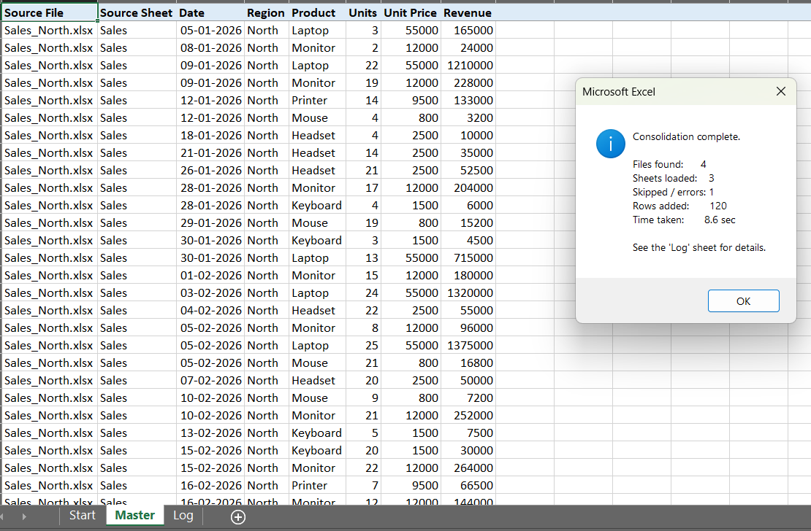
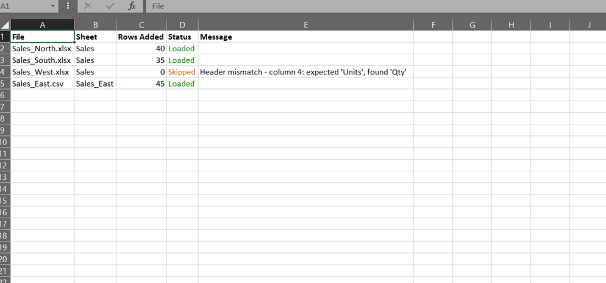

# Excel File Consolidator (VBA)

Combine dozens of Excel and CSV files into one master sheet in seconds, with header validation and a full audit log.


---

## The Problem

Every month, teams receive the same report from multiple regions, branches or vendors, each in a separate file.
Someone then opens every file, copies the data and pastes it into one master sheet. This approach is:

- **Slow:** it takes hours when there are many files
- **Error-prone:** rows get missed or pasted twice, and columns get misaligned
- **Untraceable:** once the data is merged, nobody knows which row came from which file

## The Solution

One click. Pick a folder, and the macro:

1. Reads every `.xlsx`, `.xlsm`, `.xls` and `.csv` file in it
2. Checks that each file's headers match the first file's
3. Appends all rows to a **Master** sheet, tagged with the source file and sheet name
4. Skips files that don't match instead of corrupting the output, and explains why in a **Log** sheet

## Features

| Feature | Details |
|---|---|
| ⚡ Fast | Reads and writes whole blocks via arrays rather than copying cell by cell |
| ✅ Header validation | Detects missing, extra or renamed columns, case-insensitively |
| 🔎 Traceability | Every row carries `Source File` and `Source Sheet` columns |
| 📋 Audit log | Each file is logged as **Loaded**, **Skipped** or **Error**, with a reason |
| 🧹 Blank-row cleanup | Fully empty rows are dropped automatically |
| 🛡️ Safe | Source files are opened read-only and never modified |
| 🔁 Re-runnable | Clears and rebuilds the output on every run |

## Sample Run

The `sample-data` folder contains four regional sales files. The West file deliberately uses `Qty` instead of `Units` so you can see validation in action.

**Result:** 4 files found, 3 loaded, 1 skipped, 120 rows consolidated.



**Log sheet:** shows exactly which file was skipped and why.



| File | Sheet | Rows Added | Status | Message |
|---|---|---|---|---|
| Sales_North.xlsx | Sales | 40 | Loaded | |
| Sales_South.xlsx | Sales | 35 | Loaded | |
| Sales_West.xlsx | Sales | 0 | Skipped | Header mismatch - column 4: expected 'Units', found 'Qty' |
| Sales_East.csv | Sales_East | 45 | Loaded | |

## How to Use

**Option 1: use the ready-made workbook**
1. Download `FileConsolidator.xlsm` and open it (click **Enable Content** if prompted)
2. Click **Consolidate Files**
3. Select the folder that contains your files

**Option 2: add the code to your own workbook**
1. Press `Alt + F11` to open the VBA editor
2. Go to **File → Import File** and choose `src/modConsolidator.bas`
3. Run the `ConsolidateFiles` macro (`Alt + F8`)
4. Save the workbook as `.xlsm`

## Settings

Edit the constants at the top of `modConsolidator.bas`:

| Setting | Default | Description |
|---|---|---|
| `MASTER_SHEET` | `"Master"` | Name of the output sheet |
| `LOG_SHEET` | `"Log"` | Name of the log sheet |
| `ALL_SHEETS` | `False` | `True` reads every sheet of each file, not just the first |
| `SKIP_BLANK_ROWS` | `True` | Drop rows that are completely empty |

## Assumptions

- Headers are in **row 1** and data starts in **row 2**
- The **first valid file** defines the expected column layout
- Only columns that have a header are imported

## Project Structure

```
excel-file-consolidator/
├── FileConsolidator.xlsm     # ready-to-use workbook
├── src/
│   └── modConsolidator.bas   # VBA source (readable on GitHub)
├── sample-data/              # demo input files
├── README.md
└── LICENSE
```

## Roadmap

- [ ] Option to include files from subfolders
- [ ] Column mapping, so `Qty` can be matched to `Units`
- [ ] Python version using pandas, for comparison

---

**Author:** [Swaminathan Narayanan](https://www.linkedin.com/in/swaminathan-narayanan-9781a7154/): Data Analytics | Excel & VBA Automation | Python | SQL | Power BI
